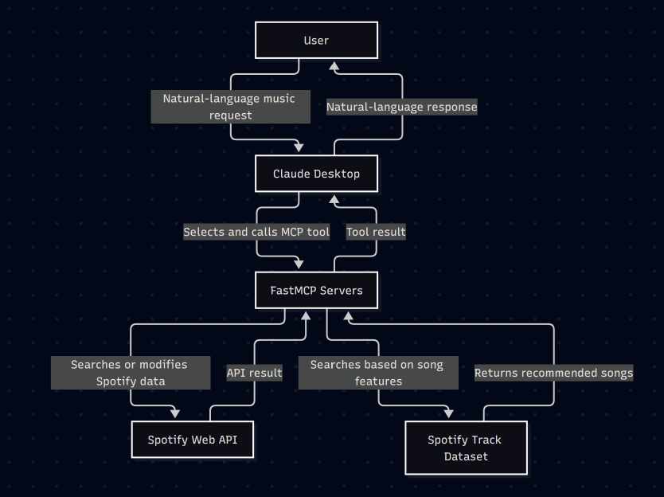
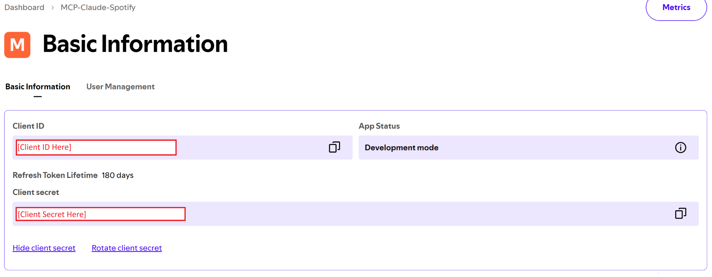
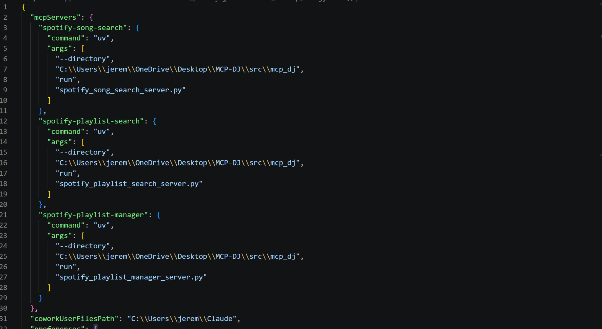
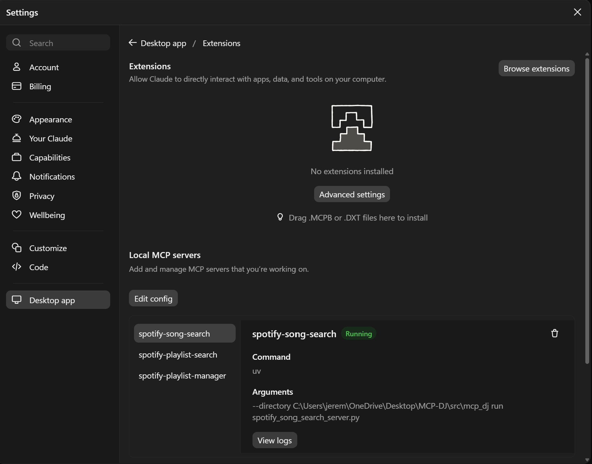
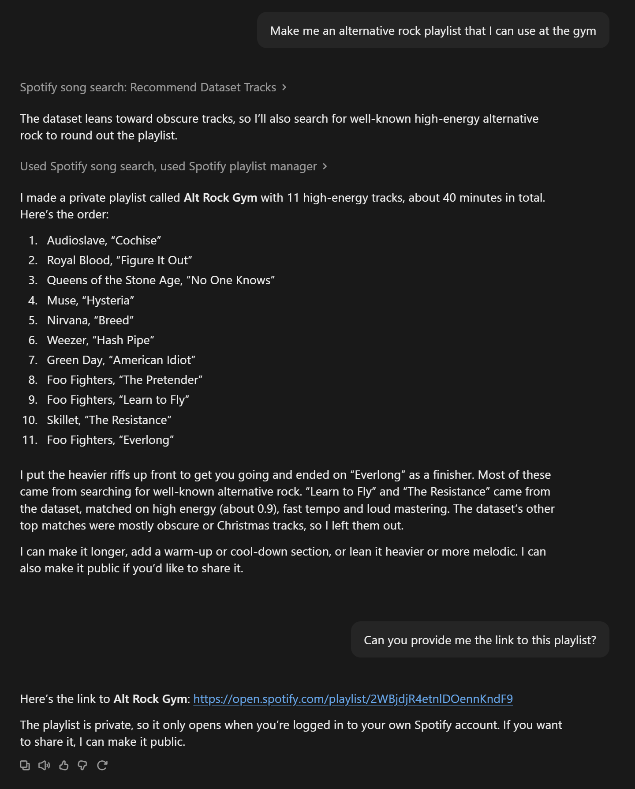

# MCP Spotify DJ

**Team members:** Jeremy Auradou and Ryan Pile  
**Contribution:** Jeremy Auradou 50%, Ryan Pile 50%  
**Course:** CSC 244 Database System Design  
**Semester:** Fall 2026

## Table of Contents

- [MCP Spotify DJ](#mcp-spotify-dj)
  - [Table of Contents](#table-of-contents)
  - [Project Overview](#project-overview)
    - [Project Objectives](#project-objectives)
    - [Technologies](#technologies)
  - [System Architecture and Data Flow](#system-architecture-and-data-flow)
    - [Basic Flow](#basic-flow)
    - [Flowchart](#flowchart)
  - [Available MCP Tools](#available-mcp-tools)
  - [Installation](#installation)
    - [Prerequisites](#prerequisites)
    - [Install Dependencies](#install-dependencies)
    - [Project Structure](#project-structure)
  - [Spotify Credentials and Authentication](#spotify-credentials-and-authentication)
    - [Environment Variables](#environment-variables)
    - [Authorize the Spotify User](#authorize-the-spotify-user)
  - [Configure Claude Desktop](#configure-claude-desktop)
    - [Configuration Checklist](#configuration-checklist)
  - [Demonstration and Testing](#demonstration-and-testing)
    - [Demonstration Screenshots](#demonstration-screenshots)
  - [Troubleshooting and Limitations](#troubleshooting-and-limitations)
    - [Troubleshooting](#troubleshooting)
    - [Known Limitations](#known-limitations)

## Project Overview

MCP Spotify DJ is a Model Context Protocol application that connects Claude Desktop to Spotify functionality through Python FastMCP servers. Users can make natural-language requests to search for songs, receive recommendations, and create, search, or modify playlists.

Example request:

> Make me an alternative rock playlist that I can use at the gym.

### Project Objectives

- Search Spotify's catalog for songs and return useful track information.
- Recommend songs using genre and audio-feature similarity from the [Spotify Tracks Dataset](https://github.com/sai-chaitanya-reddy/spotify-tracks-dataset).
- List and inspect playlists owned by the Spotify user.
- Create, update, reorder, sort, and modify playlists.
- Protect Spotify credentials and restrict playlist changes to playlists owned by the user.

### Technologies

- **Claude Desktop** - MCP client interface.
- **FastMCP and Python** - MCP server implementation.
- **Spotify Web API** - Catalog search, authentication, and playlist operations.
- **HTTPX** - HTTP requests to Spotify.
- **Spotify Tracks Dataset** - CSV dataset containing genres, audio features, and Spotify track IDs for recommendations.
- **uv** - Python package and project manager.

## System Architecture and Data Flow

Claude Desktop acts as the MCP client. Claude receives the user's request, selects an appropriate tool, and sends a structured tool call to one of the FastMCP servers. The server validates the request, then either reads the local dataset or calls the Spotify Web API.

### Basic Flow

1. The user enters a natural-language request in Claude Desktop.
2. Claude selects an MCP tool based on the tool name, description, and input schema.
3. The selected FastMCP server receives the tool call.
4. The server validates IDs, track URIs, limits, ranges, and ownership requirements.
5. If applicable, the server searches the local dataset or sends a request to Spotify.
6. The result is returned to Claude Desktop.
7. Claude presents the result or decides to call another tool.

### Flowchart

## Available MCP Tools

The project contains three main MCP servers:

- **Song Search Server** - Spotify song searches and dataset recommendations.
- **Playlist Search Server** - Playlist lists, details, and track contents.
- **Playlist Manager Server** - Playlist creation, editing, ordering, and sorting.

The following tools are exposed to Claude Desktop:

| Tool | Description |
| --- | --- |
| search_songs | Search Spotify's catalog by song, artist, genre, or another Spotify search expression. |
| recommend_dataset_tracks | Recommend local tracks using genre and/or audio-feature similarity. |
| get_my_playlists | List the user's playlists. |
| get_playlist | Return details for a playlist owned by the user. |
| get_playlist_items | Return tracks from a playlist with positions and Spotify URIs. |
| create_playlist | Create an empty Spotify playlist. |
| add_items_to_playlist | Add validated Spotify track URIs to a playlist. |
| remove_items_from_playlist | Remove selected tracks from a playlist. |
| update_playlist_details | Change a playlist's name or description. |
| reorder_playlist_items | Move one or more tracks to a different position. |
| sort_playlist | Sort an entire playlist and save a local backup before changing it. |

A single user request may result in multiple tool calls. For example, Claude may first call recommend_dataset_tracks, then search_songs, create_playlist, and add_items_to_playlist.

## Installation

This project is intended to run through the Claude Desktop application. The MCP servers are launched by Claude Desktop using its configuration file. The Claude CLI is not required.

### Prerequisites

- Python 3.10 or newer
- Git
- [uv](https://docs.astral.sh/uv/)
- Node.js LTS
- [Claude Desktop](https://claude.com/download)
- A [Spotify Developer](https://developer.spotify.com/) account and Spotify Web API application

### Install Dependencies

On Windows, install the required tools if they are not already available:

~~~powershell
winget install --id=astral-sh.uv -e
winget install OpenJS.NodeJS.LTS
~~~

Check the installed versions:

~~~powershell
python --version
git --version
uv --version
node --version
~~~

From the project root, install the Python dependencies and verify the main packages:

~~~powershell
uv sync
uv run python -c "import fastmcp, pandas, pyarrow, httpx, rapidfuzz; print('ok')"
~~~

### Project Structure

~~~text
data/
└── spotify-tracks-dataset-detailed.csv
playlist_backups/
scripts/
└── spotify_auth_attempt.py
src/
└── mcp_dj/
    ├── spotify_auth.py
    ├── spotify_playlist_manager_server.py
    ├── spotify_playlist_search_server.py
    ├── spotify_song_search_server.py
    └── __init__.py
~~~

## Spotify Credentials and Authentication

The project uses two Spotify authentication patterns:

- Catalog searches use the **Client Credentials** flow.
- Playlist access and playlist modification use user authorization with **PKCE** because those operations require the user's permission.

### Environment Variables

Create a local <code>.env</code> file from <code>.env.example</code>. Obtain the client ID and client secret from the [Spotify for Developers Dashboard](https://developer.spotify.com/dashboard). The redirect URI must match the URI registered in the Spotify application.

~~~dotenv
SPOTIFY_CLIENT_ID=your_client_id
SPOTIFY_CLIENT_SECRET=your_client_secret
SPOTIFY_REDIRECT_URI=http://127.0.0.1:8888/callback
SPOTIFY_MARKET=US
~~~

To create the Spotify application, log in to the Spotify for Developers website, open the dashboard, create a Web API project, and copy the client ID and client secret from the project's basic information page.

### Authorize the Spotify User

Run the supplied authorization script:

~~~powershell
uv run python scripts/spotify_auth_attempt.py
~~~

Then:

1. A browser window opens to Spotify's authorization page.
2. Approve the requested playlist permissions.
3. Paste the returned callback URL into the authorization script when prompted.
4. The script saves token data locally in <code>.spotify_token.json</code>.

Never commit <code>.env</code> or <code>.spotify_token.json</code> to GitHub.

## Configure Claude Desktop

Open Claude Desktop and navigate to:

**File > Settings > Desktop App > Manage Extensions > Edit Config**

Add the MCP server definitions from <code>EXAMPLE_claude_desktop_config.json</code>. Every project path must be replaced with the absolute path to the extracted project directory.

### Configuration Checklist

1. Replace each placeholder project path with the absolute local project path.
2. Confirm that each server points to the correct file under <code>src/mcp_dj</code>.
3. Save the configuration and restart Claude Desktop by selecting **File > Exit**.
4. Confirm that the MCP servers appear as connected in the Manage Extensions settings.
5. Open a new chat and confirm that the tools are available.

## Demonstration and Testing

### Demonstration Screenshots

Claude Chat

Resulting Playlist created

## Troubleshooting and Limitations

### Troubleshooting

- If the servers do not appear in Claude Desktop, verify the configuration paths and restart Claude Desktop.
- If the client ID is missing, confirm that <code>.env</code> exists in the project root.
- If the token is missing, complete the Spotify authorization process again.
- If the dataset is not found, confirm that it is located at <code>data/raw/spotify-tracks-dataset-detailed.csv</code>.
- If Spotify returns a rate-limit error, wait for the requested interval before trying again.

### Known Limitations

- The system depends on Spotify API availability, permissions, and rate limits.
- Dataset recommendations are candidates and are not automatically verified for current Spotify availability.
- Sorting large playlists may require multiple write requests.
- The current setup requires local Spotify credentials and user authorization.

